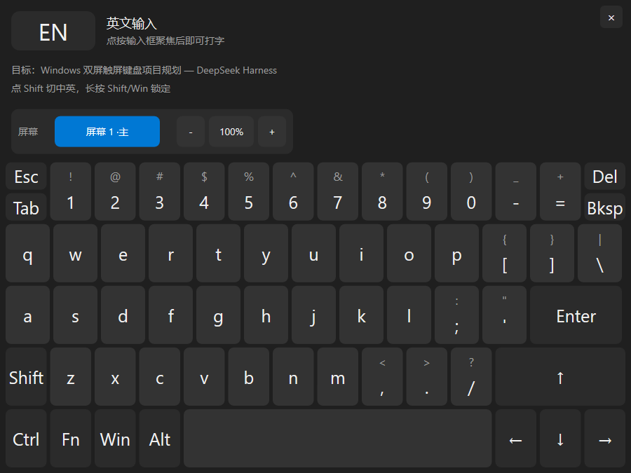
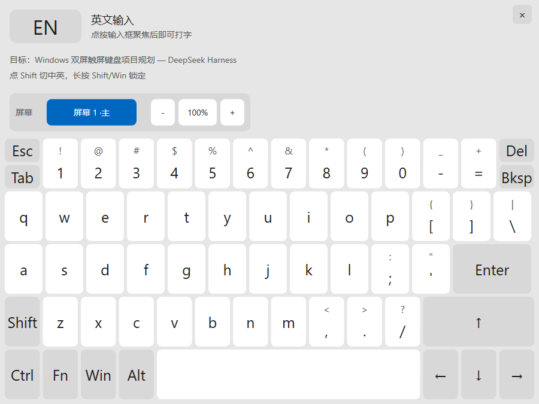

# Win10X-style Touch Keyboard

A full-screen touch keyboard for **dual-screen Windows devices**, modeled after the
Windows 10X keyboard. The primary target is a Surface Duo 1 running Windows on ARM
(two 1800×1350 panels at 200% scaling).

> Status: M1 prototype. Usable for everyday typing; APIs and interactions will change.




## Why

- The built-in Windows touch keyboard docks near the taskbar; it cannot be pinned to
  fill one specific display.
- On an unfolded dual-screen device the natural posture is app on the top screen and
  keyboard on the bottom one — Windows has no such mode.
- The Windows 10X compose-mode keyboard died with the project, so this rebuilds
  something close to it from screenshots.

## Features

- **Fills one display**: launches full-screen on the selected monitor and covers its taskbar.
- **Never steals focus**: the caret in the target app keeps blinking, which is what
  makes app-on-top / keyboard-on-bottom work.
- **Screen picker**: lists every detected monitor; one tap moves the keyboard there.
- **Win10X layout**: 14 columns × 5 rows, stacked Esc/Tab and Del/Bksp, no numpad.
- **IME aware**: with a Chinese IME, tapping Shift toggles CN/EN like a physical
  keyboard; composition and candidates stay with Microsoft Pinyin.
- **Stateful modifiers**: hold Shift for caps lock, hold Win to latch combos, and
  Alt stays down while you cycle Alt+Tab.
- **Proportional scaling**: everything is laid out on a 900×675 design canvas and
  scaled uniformly, so keys keep their shape on other screen sizes; manual 60–100% zoom.
- **Follows the system theme**: dark/light switches live; falls back to dark when the
  setting cannot be read.

## Build

Requires Visual Studio 2019 (Desktop development with C++ plus the ARM64 build tools)
and the Windows 10 SDK.

```bat
build.bat amd64 x64           :: regular PC
build.bat amd64_arm64 arm64   :: Surface Duo and other ARM64 devices
```

Output is `build\kb_x64.exe` / `build\kb_arm64.exe` — a single executable with no
runtime dependencies.

## Run

```bat
kb_arm64.exe                  :: fill the second display (default)
kb_arm64.exe --monitor 0      :: use the first display instead
kb_arm64.exe --preview        :: windowed preview, does not cover the screen
```

Click the `×` in the top-right corner to quit. Full option list:

| Option | Description |
|---|---|
| `--monitor N` | Display index (0 = topmost), default 1 |
| `--zoom NN` | Initial zoom percentage (50–100) |
| `--light` / `--dark` | Force a theme; follows the system by default |
| `--preview` | Windowed 900×675 preview |
| `--no-topmost` | Do not stay on top |
| `--autoclose MS` | Quit after N milliseconds (testing) |
| `--log` | Write `kb_log.txt` debug output |

## Known limitations

- Single pointer: two-finger Shift+letter is not supported; modifiers latch on tap.
- No swipe typing, no emoji/GIF panel, no candidate bar — the system IME handles candidates.
- Cannot inject into elevated windows (UIPI); the logon screen and UAC secure desktop
  are out of reach.
- Some pure-TSF apps (certain UWP apps) may report their IME state as EN.

